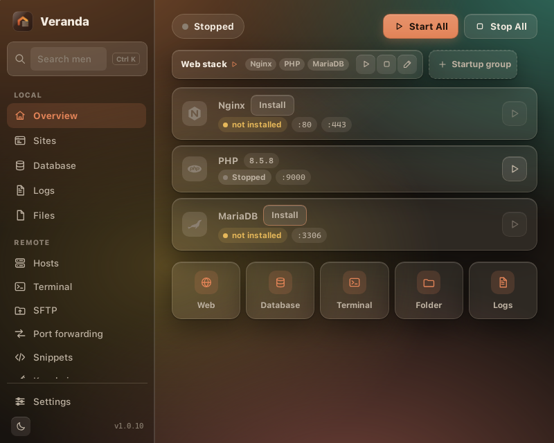

<p align="center">
  Meja kerja web lokal yang kecil dan ramah: server web, PHP, database, cache, dan penangkap email dalam satu jendela,<br>
  plus klien SSH, editor file, dan cara membawa semuanya ke komputer berikutnya. Matikan yang tidak Anda pakai.<br>
  Beberapa klik, dan <code>https://my-app.test</code> berjalan di komputer Anda sendiri.
</p>

<p align="center">
  <a href="#pemasangan">Pemasangan</a> ·
  <a href="#apa-yang-anda-dapat">Apa yang Anda dapat</a> ·
  <a href="#lima-menit-pertama">Lima menit pertama</a> ·
  <a href="README.md">English</a>
</p>

---

Veranda untuk siapa saja yang membangun untuk web dan ingin perlengkapan lokalnya langsung jalan.
Ia melayani situs HTML dan JavaScript biasa, aplikasi PHP (WordPress, Laravel, Symfony, dan
kawan-kawan), serta memberi proyek apa pun database lokal, cache, penangkap email, dan Node.js.
Anda hanya memilih bagian yang dibutuhkan; tidak ada yang dipaksakan, dan tidak ada yang
berjalan tanpa Anda nyalakan.



## Apa yang Anda dapat

- **Semua yang biasa dibutuhkan, tanpa yang tidak perlu.** PHP (8.1 sampai 8.5 terbaru), server
  web (Nginx atau Apache), MariaDB atau MySQL, PostgreSQL, MongoDB, Node.js, Python, Adminer, dan
  phpMyAdmin.
  Semuanya opsional dan versinya Anda pilih dari daftar. Beberapa versi bisa terpasang berdampingan.
- **Folder menjadi situs.** Taruh folder proyek di `www/`, maka ia dilayani di
  `https://nama-folder.test` dengan sertifikat yang dipercaya browser. Berlaku untuk situs
  statis, aplikasi PHP, dan apa pun yang punya `index.html` atau `index.php`; folder `public/`
  Laravel dan Symfony dikenali otomatis.
- **Tidak perlu menebak.** Setiap layanan menampilkan status, port, dan versi. Unduhan punya
  bilah kemajuan. Tab Log menunjukkan apa yang salah, dengan warna.
- **Ringan.** Aplikasinya sekitar 9 MB. Runtime diunduh dari server resminya hanya saat Anda
  minta, diverifikasi dengan checksum, dan bisa dihapus per versi.
- **Aman sejak awal.** Semua layanan hanya mendengarkan di localhost. Database mendapat kata
  sandi root acak saat pertama dijalankan. HTTPS memakai otoritas sertifikat lokal yang tidak
  pernah keluar dari komputer Anda. Tanpa akun, tanpa telemetri.
- **Selalu mutakhir.** Veranda memberi tahu saat rilis baru terbit dan memperbarui dirinya dengan
  satu klik (atau otomatis, kalau Anda mau). Daftar paket selalu tahu PHP, MariaDB, dan lainnya
  yang terbaru.
- **Server Anda juga.** Bagian Remote adalah klien SSH lengkap: host dengan grup dan tag, tab
  terminal, SFTP dengan seret-lepas, port forwarding (local, remote, SOCKS5), snippet, kunci dan
  identitas, known hosts, serta riwayat. Kunci dan kata sandi tetap di komputer Anda, di
  penyimpanan kredensial sistem operasi.
- **Mengedit file Anda.** Editor bawaan dengan pratinjau Markdown, tabel CSV, pemeriksaan
  JSON, dan pewarnaan sintaks untuk bahasa web yang umum; Ctrl+S menyimpan langsung.
- **Ikut pindah.** Settings > Pindah ke komputer lain mengemas pengaturan, proyek, kunci SSH
  dan git, setelan VS Code dan Claude Code ke satu file terenkripsi; pulihkan di komputer baru
  (OS apa pun) dan Veranda memasang ulang paket, meng-clone repository, dan memasang ekstensi
  Anda lagi.
- **Terkunci saat Anda pergi.** Kunci aplikasi opsional meminta PIN atau kata sandi saat dibuka
  dan setelah tidak dipakai beberapa saat, dengan dua faktor dari aplikasi autentikator apa pun
  (offline, tanpa akun). Yang disimpan hanya hash bergaram.
- **Tampilan sesuai selera.** Empat gaya (Beranda, Kaca, Kertas, Arang), masing-masing terang
  dan gelap, dari Settings → Tampilan.
- **Mengawasi server Anda.** Setiap terminal SSH menampilkan CPU, memori, disk (semua mount),
  dan uptime server dalam strip tipis, dibaca dari `/proc` lewat koneksi yang sudah ada.
- **Ganti mesin database tanpa kehilangan data.** Sites → Migrate menyalin semua database dari
  MariaDB ke MySQL atau sebaliknya, dengan bilah kemajuan yang bisa dijeda atau dibatalkan; juga
  mengimpor proyek dan database dari Laragon, XAMPP, dan FlyEnv.
- **Linux, Windows, dan macOS**, mode gelap dan terang.

## Pemasangan

Unduh berkas untuk sistem Anda dari **[rilis terbaru](https://github.com/livrens/veranda/releases/latest)**.
(Ganti `1.0.9` di bawah dengan versi yang Anda unduh.)

### Linux

**Debian, Ubuntu, Kubuntu, Linux Mint, Pop!_OS** (`.deb`):
```sh
sudo apt install ./Veranda_1.0.9_amd64.deb
```
Veranda muncul di menu aplikasi. Pembaruan dipasang dari dalam aplikasi: paket bertanda tangan
diunduh lalu dipasang lewat dialog kata sandi sistem.

**Fedora, openSUSE, RHEL** (`.rpm`):
```sh
sudo dnf install ./Veranda-1.0.9-1.x86_64.rpm     # atau: sudo zypper install ./Veranda-*.rpm
```

**Distribusi apa pun** (`.AppImage`, tanpa pemasangan):
```sh
chmod +x Veranda_1.0.9_amd64.AppImage
./Veranda_1.0.9_amd64.AppImage
```
AppImage bisa memperbarui dirinya dari dalam aplikasi. Pindahkan ke folder seperti
`~/Applications` agar rapi.

Port 80 dan 443 di Linux butuh izin satu kali: tekan **Start All** di Veranda lalu ikuti
petunjuknya, atau jalankan `veranda doctor --fix-ports` dari CLI. Bisa juga memakai 8080/8443 di
Settings.

### Windows 10 / 11

1. Unduh `Veranda_1.0.9_x64-setup.exe` lalu jalankan. Jika SmartScreen berkata "Windows protected
   your PC", klik **More info → Run anyway** (pemasangnya masih baru dan belum banyak diunduh;
   hanya itu arti peringatannya).
2. Ikuti pemasangnya. Veranda ditambahkan ke menu Start. Runtime Microsoft WebView2 dipasang
   otomatis jika komputer Anda belum punya.
3. Perlu MSI untuk pemasangan di perusahaan? `Veranda_1.0.9_x64_en-US.msi` ada di rilis yang sama.

Pembaruan dipasang langsung dari dalam aplikasi.

### macOS (Apple Silicon dan Intel)

1. Unduh `Veranda_1.0.9_universal.dmg`, buka, lalu seret **Veranda** ke **Applications**.
2. Peluncuran pertama: klik kanan (atau Control-klik) Veranda → **Open** → **Open**. macOS bertanya
   sekali karena aplikasi belum ditandatangani sertifikat Apple Developer.
3. Pembaruan dipasang langsung dari dalam aplikasi.

### Baris perintah (opsional)

Setiap rilis juga menyertakan alat baris perintah `veranda` dengan fitur yang sama:

```sh
# Linux / macOS
chmod +x veranda-cli-linux-x86_64 && sudo mv veranda-cli-linux-x86_64 /usr/local/bin/veranda
# Windows (PowerShell): pindahkan veranda-cli-windows-x86_64.exe ke folder yang ada di PATH, ganti nama menjadi veranda.exe

veranda init && veranda install php && veranda install mariadb && veranda start
```

### Di mana semuanya disimpan

Peluncuran pertama membuat folder `veranda` di direktori home Anda (`~/veranda`, atau
`C:\Users\anda\veranda`) untuk proyek (`www/`), pengaturan, runtime yang diunduh, database, dan log.
Tidak ada bagian lain dari sistem yang disentuh. Mencopot aplikasi tetap menyisakan folder itu
untuk Anda.

Panduan lengkap tiap layar: [docs/USAGE.id.md](docs/USAGE.id.md).

## Lima menit pertama

1. Buka Veranda → klik **PHP** dan **MariaDB** di sidebar → tab **Versi** → **Install**. Server web-nya Nginx atau Apache: di Windows diunduh Veranda, di Linux dan macOS dipakai yang terpasang lewat package manager Anda.
2. **Settings → Trust local CA** supaya `https://*.test` menampilkan gembok di browser.
3. **Dashboard → Start All**. Saat Veranda meminta memperbarui berkas hosts, izinkan; itu yang
   membuat `aplikasi-saya.test` mengarah ke komputer Anda.
4. **Sites → New project**: WordPress, Laravel, Symfony, templat Composer apa pun, URL git, atau
   folder kosong. Database dengan nama yang sama dibuatkan untuk Anda.
5. Buka `https://aplikasi-saya.test`. Untuk situs HTML atau JavaScript biasa, cukup taruh
   foldernya di `www/` lalu tekan **Sync** di Sites.

Masuk ke database: host `127.0.0.1`, pengguna `root`, kata sandi di **Database → Show**.

## Remote (SSH)

Grup **Remote** di sidebar mengelola server seperti klien SSH khusus:

- **Host**: tambah host (atau impor `~/.ssh/config`), pilih autentikasi kata sandi, kunci,
  identitas, atau agent; kelompokkan, beri tag dan warna. Klik dua kali untuk membuka terminal;
  tombol SFTP membuka penjelajah file host itu. "Quick connect" menerima `user@host:22` tanpa
  menyimpan apa pun.
- **Terminal**: tab SSH dan lokal. Ctrl+Shift+C/V salin dan tempel, Ctrl+Shift+F mencari,
  Ctrl+Shift+T membuka shell lokal. Ikon gerigi mengatur font, tema, kursor, dan keep-alive.
- **SFTP**: komputer ini di kiri, server di kanan. Seret file antar panel, atau pilih lalu
  pakai tombol panah. Klik dua kali file teks di server untuk menyuntingnya langsung.
- **Port forwarding**: `127.0.0.1:3307 → 127.0.0.1:3306` lewat server membuat database server
  terjangkau dari alat lokal Anda; aturan dynamic memberi proxy SOCKS5.
- **Keychain**: buat atau impor kunci, pasang kunci publik ke host dengan satu klik, dan buat
  identitas (pengguna + kata sandi/kunci) yang diwarisi host dan grup.

Koneksi pertama ke server menampilkan sidik jari kuncinya; setelah diterima, kunci dicatat di
`etc/remote/known_hosts`. Kunci yang berubah ditandai merah. Rahasia disimpan di penyimpanan
kredensial sistem (atau `secrets/remote-secrets.json`, hanya terbaca pengguna Anda, jika tidak
ada). Veranda tidak pernah membaca data klien SSH lain.

## Cara kerjanya

Veranda ditulis dengan Rust dan antarmuka web kecil (Tauri 2) yang memakai web view bawaan sistem
operasi, jadi tidak ada browser yang dibundel. Ia menulis konfigurasi yang diperketat untuk
server yang dikelolanya, mengawasi prosesnya, dan menyunting berkas hosts lewat pembantu kecil
yang hanya menyentuh baris miliknya. Rincian: [docs/ARCHITECTURE.md](docs/ARCHITECTURE.md),
[docs/SECURITY.md](docs/SECURITY.md). Membangun dari sumber: [docs/BUILD.md](docs/BUILD.md).

## Lisensi

Veranda gratis dan sumber terbuka di bawah [Lisensi MIT](LICENSE). Ini implementasi orisinal tanpa
kode, templat, atau aset dari produk serupa lain; nama produk lain dalam dokumen ini milik
pemiliknya masing-masing. Dependensi Rust dan lisensinya tercantum di
[THIRD_PARTY_NOTICES.md](THIRD_PARTY_NOTICES.md). Runtime diunduh dari server resminya atas
permintaan Anda dan tidak didistribusikan ulang di sini.
