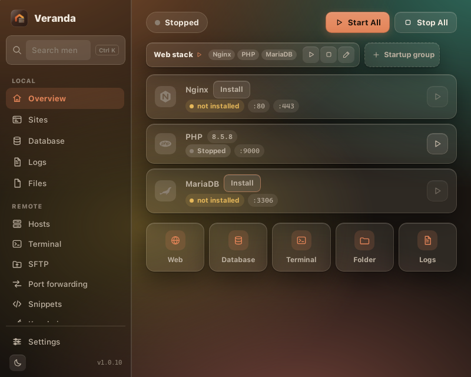

<p align="center">
  
</p>

<h1 align="center">Veranda</h1>

<p align="center">
  A small, friendly local web workbench: web server, PHP, database, cache and mail catcher in one window,<br>
  with an SSH client, a file editor and a way to carry it all to your next computer. Switch off what you do not use.<br>
  A few clicks, and <code>https://my-app.test</code> is running on your own machine.
</p>

<p align="center">
  <a href="#install">Install</a> ·
  <a href="#what-you-get">What you get</a> ·
  <a href="#first-five-minutes">First five minutes</a> ·
  <a href="README.id.md">Bahasa Indonesia</a>
</p>

---

Veranda is for anyone who builds for the web and wants the usual local setup to just work. It
serves plain HTML and JavaScript sites, PHP applications (WordPress, Laravel, Symfony and
friends), and gives any project a local database, cache, mail catcher and Node.js. You pick
only the parts you need; nothing is forced on you and nothing runs that you did not start.



## What you get

- **Everything you usually need, nothing you don't.** PHP (8.1 to the newest 8.5), a web server
  (Nginx or Apache), MariaDB or MySQL, PostgreSQL, MongoDB, Node.js, Python, Adminer and
  phpMyAdmin. Each one is
  optional and you choose the version from a list. Several versions can live side by side.
- **Folders become websites.** Put a project folder in `www/` and it is served at
  `https://folder-name.test` with a certificate your browser trusts. Works for static sites,
  PHP apps and anything with an `index.html` or `index.php`; Laravel and Symfony's `public/` is
  detected automatically.
- **No guessing.** Every service shows its state, port and version. Downloads have a progress
  bar. A Logs tab shows what went wrong, in colour.
- **Light.** The app is about 9 MB. Runtimes are downloaded from their official servers only
  when you ask, verified with checksums, and can be removed per version.
- **Safe by default.** Everything listens on localhost only. The database gets a random root
  password on first start. HTTPS uses a local certificate authority that never leaves your
  computer. No accounts, no telemetry.
- **Stays current.** Veranda tells you when a new release is out and updates itself on click (or
  automatically, if you prefer). The package list always knows the newest PHP, MariaDB and the
  rest.
- **Your servers too.** The Remote section is a full SSH client: hosts with groups and tags,
  terminal tabs, SFTP with drag and drop, port forwarding (local, remote, SOCKS5), snippets,
  keys and identities, known hosts and history. Keys and passwords stay on your computer, in the
  operating system's credential store.
- **Edits your files.** A built-in editor with Markdown preview, CSV tables, JSON checks and
  syntax colouring for the usual web languages; Ctrl+S saves in place.
- **Moves with you.** Settings > Move to another computer packs your setup, projects, SSH and
  git keys, VS Code and Claude Code settings into one encrypted file; restore it on the new
  machine (any OS) and Veranda reinstalls the packages, clones your repositories and installs
  your extensions again.
- **Locks when you walk away.** An optional app lock asks for a PIN or password at launch and
  after idle time, with two-factor from any authenticator app (offline, no account). Only a
  salted hash is stored.
- **Looks the way you like.** Four looks (Porch, Glass, Paper, Charcoal), each in light and dark,
  from Settings → Appearance.
- **Keeps an eye on your servers.** Every SSH terminal shows the server's CPU, memory, disk
  (every mount) and uptime in a thin strip, read from `/proc` over the existing connection.
- **Switches database engines without losing data.** Sites → Migrate copies every database
  from MariaDB to MySQL or back, with a progress bar you can pause or cancel; it also imports
  projects and databases from Laragon, XAMPP and FlyEnv.
- **Linux, Windows and macOS**, dark and light mode.

## Install

Download the file for your system from the **[latest release](https://github.com/livrens/veranda/releases/latest)**.
(Replace `1.0.9` below with the version you downloaded.)

### Linux

**Debian, Ubuntu, Kubuntu, Linux Mint, Pop!_OS** (`.deb`):
```sh
sudo apt install ./Veranda_1.0.9_amd64.deb
```
Veranda appears in your application menu. Updates install in place from the app: it downloads the
signed package and installs it through the system's password prompt.

**Fedora, openSUSE, RHEL** (`.rpm`):
```sh
sudo dnf install ./Veranda-1.0.9-1.x86_64.rpm     # or: sudo zypper install ./Veranda-*.rpm
```

**Any distribution** (`.AppImage`, no installation):
```sh
chmod +x Veranda_1.0.9_amd64.AppImage
./Veranda_1.0.9_amd64.AppImage
```
The AppImage can update itself from inside the app. Move it to a folder like `~/Applications`
if you want to keep it around.

Ports 80 and 443 need a one-time permission on Linux: in Veranda press **Start All** and follow the
hint, or run `veranda doctor --fix-ports` from the CLI. You can also use 8080/8443 in Settings.

### Windows 10 / 11

1. Download `Veranda_1.0.9_x64-setup.exe` and run it. If SmartScreen says "Windows protected your
   PC", click **More info → Run anyway** (the installer is new and not yet widely downloaded;
   that is all the warning means).
2. Follow the installer. Veranda is added to the Start menu. The Microsoft WebView2 runtime is
   installed automatically if your PC does not have it.
3. Prefer MSI for company deployment? `Veranda_1.0.9_x64_en-US.msi` is in the same release.

Updates install in place from the app.

### macOS (Apple Silicon and Intel)

1. Download `Veranda_1.0.9_universal.dmg`, open it and drag **Veranda** into **Applications**.
2. First launch: right-click (or Control-click) Veranda → **Open** → **Open**. macOS asks this once
   because the app is not signed with an Apple Developer certificate.
3. Updates install in place from the app.

### Command line (optional)

Every release also includes a `veranda` command-line tool with the same features as the app:

```sh
# Linux / macOS
chmod +x veranda-cli-linux-x86_64 && sudo mv veranda-cli-linux-x86_64 /usr/local/bin/veranda
# Windows (PowerShell): move veranda-cli-windows-x86_64.exe to a folder on your PATH and rename it veranda.exe

veranda init && veranda install php && veranda install mariadb && veranda start
```

### Where things live

The first launch creates a `veranda` folder in your home directory (`~/veranda`, or
`C:\Users\you\veranda`) for projects (`www/`), settings, downloaded runtimes, databases and logs.
Nothing else on your system is touched. Uninstalling the app leaves that folder for you.

Full walkthrough of every screen: [docs/USAGE.md](docs/USAGE.md). Installer warnings on
Windows/macOS and how code signing removes them: [docs/SIGNING.md](docs/SIGNING.md).

## First five minutes

1. Open Veranda → click **PHP** and **MariaDB** in the sidebar → **Versions** tab → **Install**. The web server is Nginx or Apache: Veranda downloads it on Windows and uses the one installed with your package manager on Linux and macOS.
2. **Settings → Trust local CA** so `https://*.test` shows a padlock in your browser.
3. **Dashboard → Start All**. When Veranda asks to update your hosts file, allow it; that is what
   makes `my-app.test` point to your computer.
4. **Sites → New project**: WordPress, Laravel, Symfony, any Composer template, a git URL, or an
   empty folder. A database with the same name is created for you.
5. Open `https://my-app.test`. For a plain HTML or JavaScript site, just drop the folder into
   `www/` and press **Sync** in Sites.

Database login: host `127.0.0.1`, user `root`, password under **Database → Show**.

## Remote (SSH)

The **Remote** group in the sidebar manages servers the way a dedicated SSH client does:

- **Hosts**: add a host (or import `~/.ssh/config`), pick password, key, identity or agent
  authentication, group it, tag it, give it a colour. Double-click to open a terminal; the SFTP
  button opens the file browser for that host. "Quick connect" takes `user@host:22` without
  saving anything.
- **Terminal**: SSH and local tabs. Ctrl+Shift+C/V copy and paste, Ctrl+Shift+F searches,
  Ctrl+Shift+T opens a local shell. The gear sets font, theme, cursor and keep-alive.
- **SFTP**: this computer on the left, the server on the right. Drag files across, or select
  and use the arrows. Double-click a text file on the server to edit it in place.
- **Port forwarding**: `127.0.0.1:3307 → 127.0.0.1:3306` through a server reaches its database
  from your local tools; dynamic rules give you a SOCKS5 proxy.
- **Keychain**: generate or import keys, install a public key on a host with one click, and
  define identities (user + password/key) that hosts and groups inherit.

The first connection to a server shows its key fingerprint; accept it and it is recorded in
`etc/remote/known_hosts`. A changed key is flagged in red. Secrets go to the system credential
store (or `secrets/remote-secrets.json`, user-readable only, when there is none). Veranda never
reads other SSH clients' data stores.

## How it works

Veranda is written in Rust with a small web-based interface (Tauri 2) that uses the web view your
operating system already ships, so there is no bundled browser. It writes hardened configuration
for the servers it manages, supervises their processes, and edits the hosts file through a tiny
helper that only touches the lines it owns. Details: [docs/ARCHITECTURE.md](docs/ARCHITECTURE.md),
[docs/SECURITY.md](docs/SECURITY.md). Building from source: [docs/BUILD.md](docs/BUILD.md).

## License

Veranda is free and open source under the [MIT License](LICENSE). It is an original implementation
and contains no code, templates or assets from other local-stack products; other product names
in these docs belong to their owners. Rust dependencies and their licenses are listed in
[THIRD_PARTY_NOTICES.md](THIRD_PARTY_NOTICES.md). Runtimes are downloaded from their official
servers at your request and are not redistributed here.
